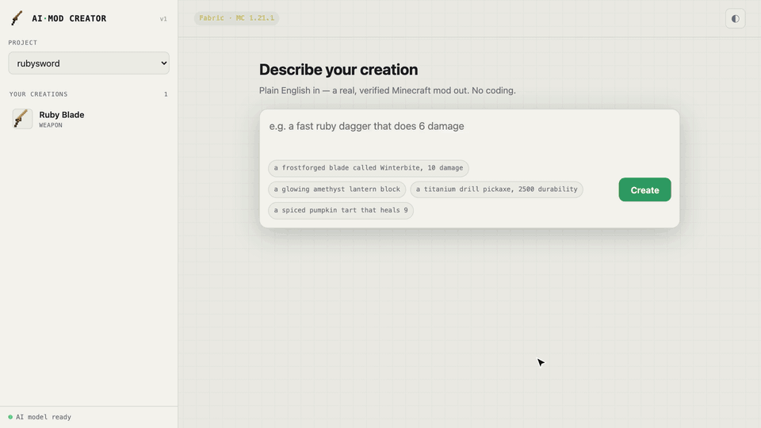

# AI-mod creator

Describe a small mod in plain English and play it in your own Minecraft game. Everything runs on
your laptop, offline, with a tiny open model.

```text
"a ruby sword called Ruby Blade with 1200 durability and 9 damage"
   → a real Fabric mod, built, checked inside Minecraft, and ready to play
```

<p align="center">
  <a href="docs/media/demo.mp4"></a>
</p>


**Status: early alpha.** It handles simple items, weapons, tools, food, blocks and recipes, and
it's happiest with clear, specific requests. Try it in a fresh test world. Bug reports and "I wish
it could…" ideas are very welcome in [Issues](../../issues).

## How it works

1. A small local model ([`ai-mod-create-270smol`](https://huggingface.co/sjdthree/ai-mod-create-270smol),
   a 270M-parameter Gemma fine-tune) turns your sentence into a few structured operations.
2. The engine validates those operations against strict rules and your project's current state.
3. It generates the mod's Java code and resources deterministically, builds it with Gradle, and
   runs a check inside Minecraft before calling it done.
4. Every change is a transaction, so you can refine ("make it stronger", "rename it Sting") or undo.

The model only picks operations; the engine writes all of the code. Same request, same state,
same mod.

## Get started

- **Download:** the [latest release](https://github.com/sjdthree/ai-mod-creator/releases/latest)
  (macOS Apple Silicon `.dmg`, Windows `-setup.exe` / `.msi`).
- **Install the app:** [docs/INSTALL.md](docs/INSTALL.md) (macOS Apple Silicon, Windows).
  The installers are unsigned during the alpha, so the first launch needs one extra click.
- **Build from source / use the CLI:** [docs/GETTING_STARTED.md](docs/GETTING_STARTED.md).
- **Using it:** [docs/USER_GUIDE.md](docs/USER_GUIDE.md).

You need Java 21 to build mods, and Minecraft Java Edition to play them in your own game.

Targets Minecraft **1.21.1**. The desktop app builds **Fabric** mods (Fabric Loader + Fabric API);
the `amc` CLI builds **NeoForge** mods by default (`--loader fabric` for Fabric).

## Repository layout

```text
apps/desktop/    Tauri desktop app (the friendly front end)
crates/          Rust engine: intent bridge, validator, state, generator, build, verify, CLI
schemas/         MCL (the operation language) JSON Schemas
docs/            Guides, ADRs, design notes
AI_Mod_Creator_Engineering_Package_v1.0/   The original design specs
```

The project was developed in a private repository; public history starts at this alpha.

## Development

```bash
./scripts/ci.sh        # fmt, clippy, tests, license check: the same as CI
```

Contributions are welcome. See [CONTRIBUTING.md](CONTRIBUTING.md) and our
[Code of Conduct](CODE_OF_CONDUCT.md). Report security problems privately: [SECURITY.md](SECURITY.md).

## License

The code is [Apache-2.0](LICENSE); see [NOTICE](NOTICE). The model weights are distributed
separately under the [Gemma Terms of Use](https://ai.google.dev/gemma/terms).

Not an official Minecraft product. Not approved by or associated with Mojang or Microsoft.
